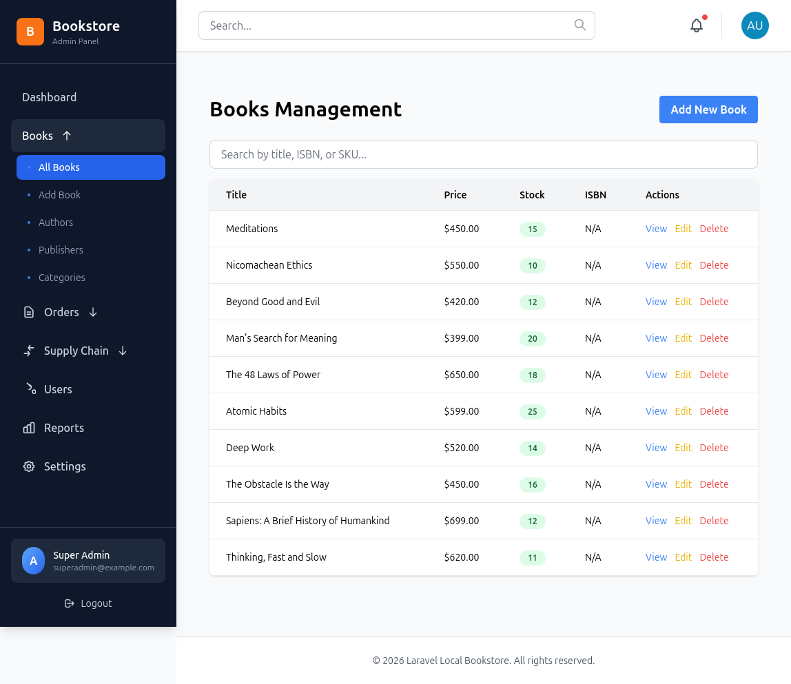
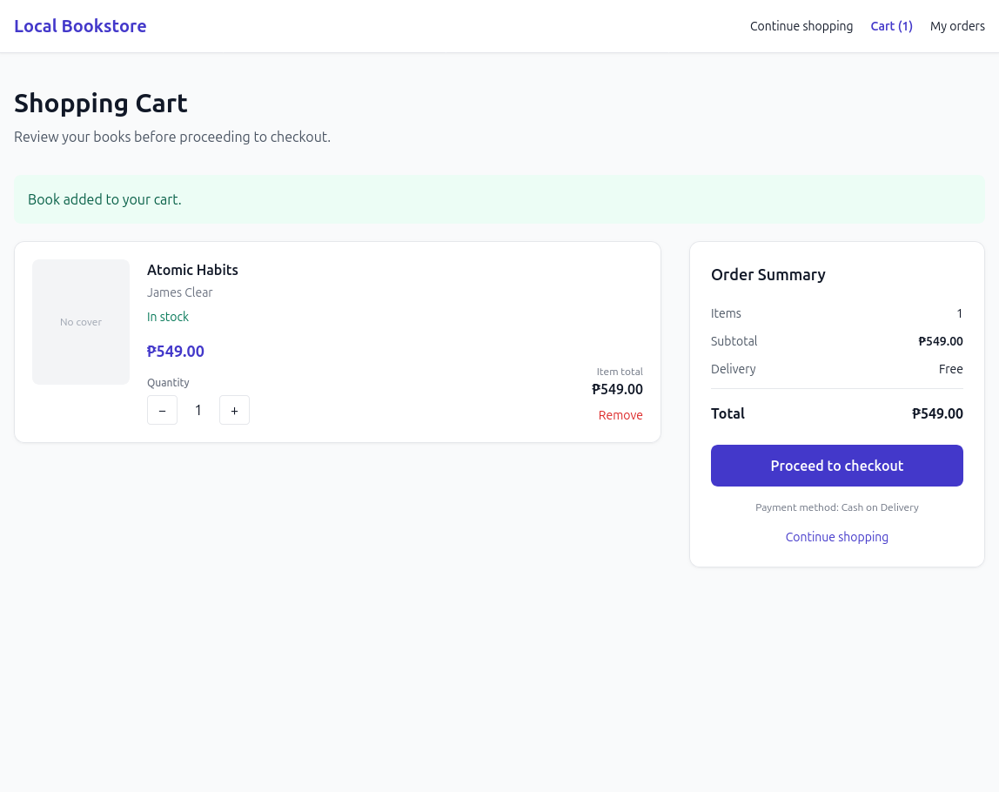
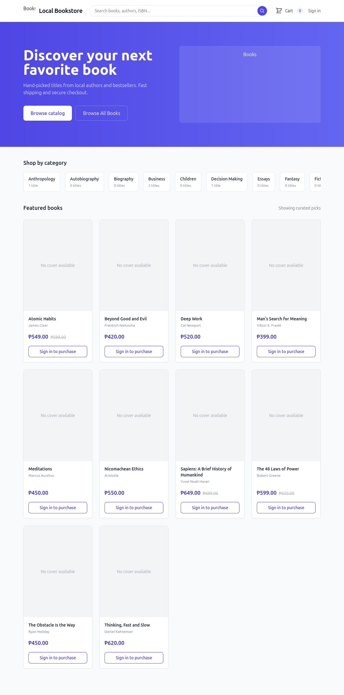
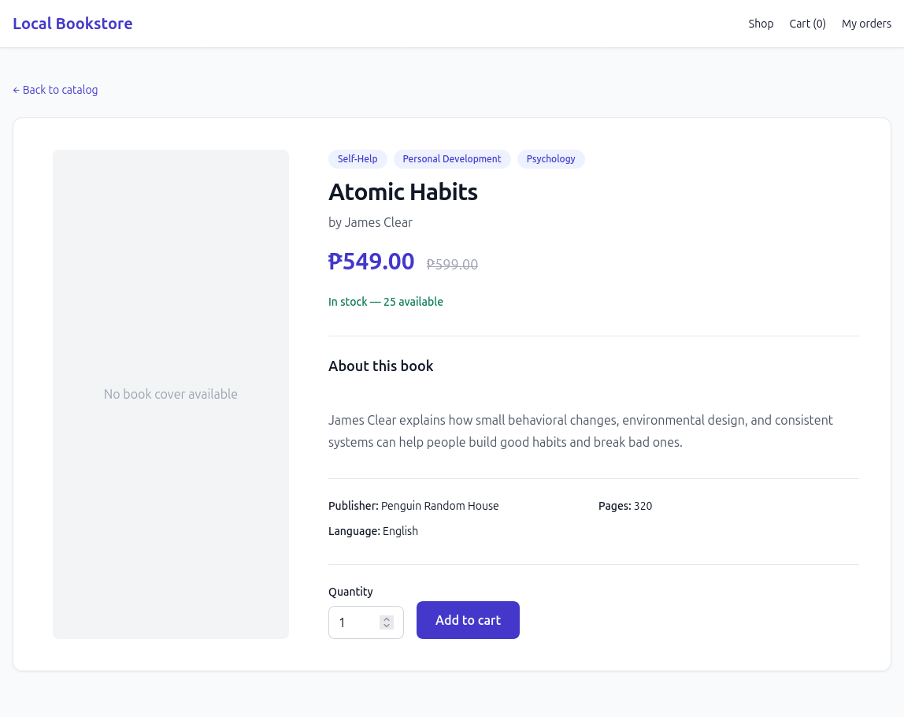

# Development Roadmap

The project is developed incrementally, with the goal of maintaining a functional and presentable online bookstore.

### Completed — Admin Management

- [x] Admin Dashboard
- [x] Book Management
- [x] Author Management
- [x] Category Management
- [x] Publisher Management
- [x] Supplier Management
- [x] Inventory Monitoring
- [x] Inventory Adjustments
- [x] Stock Movement History
- [x] Purchase Order Creation and Management
- [x] Partial Purchase Order Receiving

### Completed — Customer Storefront

- [x] Homepage and Book Catalog
- [x] Book Details
- [x] Category-based Book Browsing
- [x] Book Search and Sorting
- [x] Shopping Cart
- [x] Checkout Workflow
- [x] Cash on Delivery (COD)
- [x] Metro Manila Delivery Address Validation
- [x] Customer Order History
- [x] Customer Order Details
- [x] Pending Order Cancellation

### Future Improvements

- [ ] Admin Order Management
- [ ] Admin Order Status Updates
- [ ] COD Payment Status Management
- [ ] Additional Automated Tests
- [ ] UI and User Experience Improvements

---

## Project Notes

This is a personal development project intended to demonstrate practical Laravel application development.

The goal is to build a functional online bookstore with a manageable administrative workflow, rather than an enterprise-level inventory or supply-chain platform.

The implementation prioritizes maintainable code, clear separation of responsibilities, and realistic business rules appropriate for a small bookstore.

---

## Project Overview

